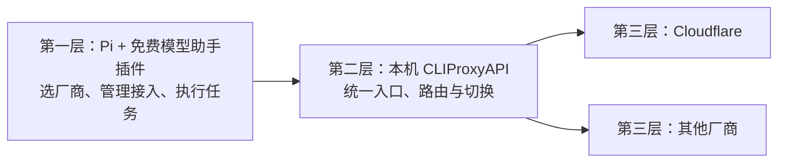
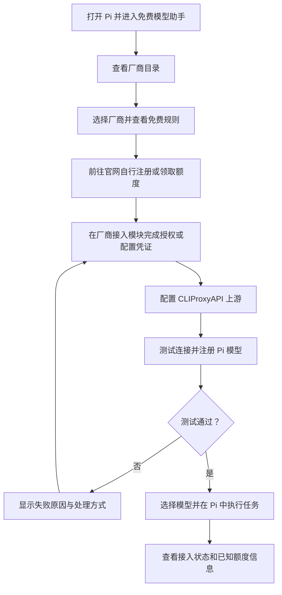
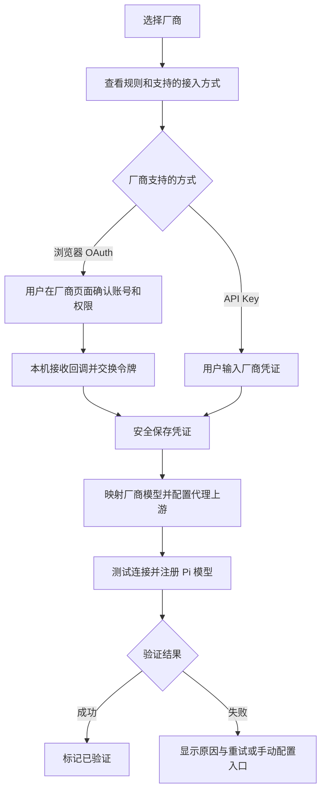
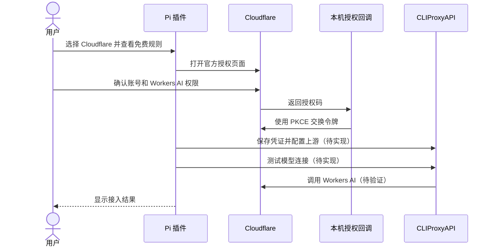
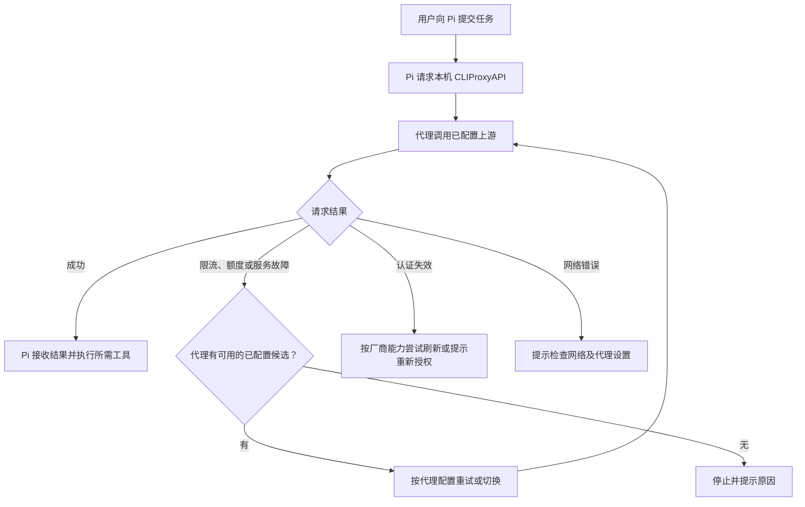
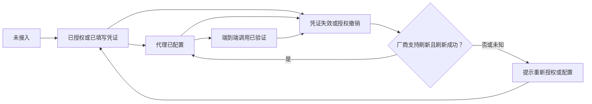
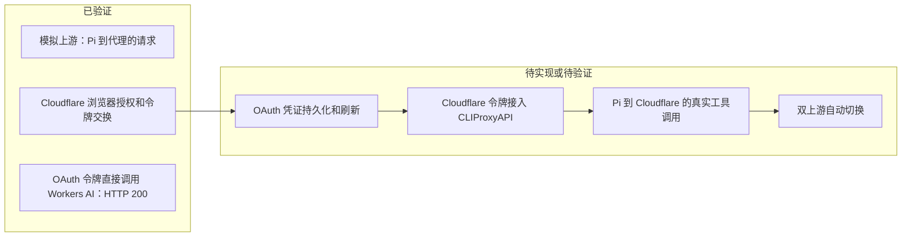
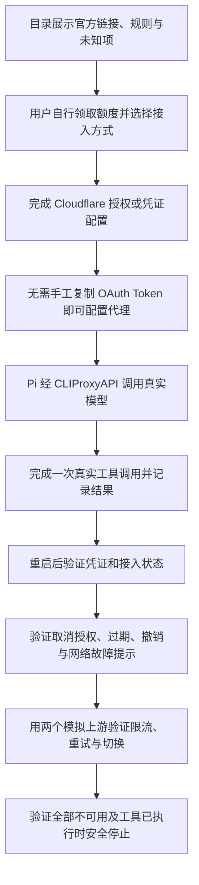

# 免费模型助手 PRD

状态：开发中

更新日期：2026-11-15

目标：用户在 Pi 中发现免费模型服务、自己领取额度并完成接入，然后使用模型完成编程或个人助手任务。首个真实接入目标是 Cloudflare Workers AI。

> 以下流程图描述产品目标；具体完成情况见「当前进度」。

## 一、整体架构

- 厂商接入模块位于 Pi 插件内；CLIProxyAPI 是独立本机进程，默认仅监听 `127.0.0.1` 并要求客户端密钥。
- “额度池”是已接入厂商及模型的统一视图；真实额度仍在各厂商账号中，不会变成通用 Token。余额不可可靠查询时显示“未知”。
- 插件不能保证免费额度用尽后不会收费；用户需确认厂商的免费范围和超额规则。

## 二、用户完整流程

目录需提供官方链接、免费额度及刷新周期、API 适用范围、模型、限制、超额行为与核实日期；未知项明确标记。用户自行领取，插件不代签或自动注册。首版入口为 `/free-models`，链接应支持打开浏览器或手动复制。

## 三、厂商接入模块

共用厂商选择、规则展示、状态和连接测试；每家厂商分别适配官方链接、授权方式、模型映射、凭证更新和费用规则。目录中出现厂商不代表已经支持自动接入。仅在端到端测试通过后标记“已验证”。

### Cloudflare 接入示例

- Cloudflare 目标提供浏览器授权和手动 API Token 两种方式；浏览器授权采用 Authorization Code + PKCE，不读取浏览器 Cookie。授权不等于自动领取或开通额度。
- 授权请求使用 Workers AI Read、Write 权限。测试用私有 OAuth 客户端是否可用于其他用户，以及正式发布的注册、验证和分发要求，仍需核实。
- CLIProxyAPI 当前未发现内置 Cloudflare OAuth 登录；需验证其 OpenAI 兼容上游是否接受该令牌及如何同步更新。必要时再评估扩展或本机适配。

## 四、使用、重试与切换

此图是目标行为：CLIProxyAPI 的切换条件及不同厂商错误分类需要测试，不能假设所有错误都能切换。用户需事先确认候选厂商与模型；只有一个上游时无法切换。

代理可能在一次请求内部重试；代理返回失败后 Pi 也可能按自身配置重试。现有 `pi-auto-fallback` 是独立机制，需控制两层重试的延迟和消耗。若工具已写文件或执行命令，恢复时不得盲目重放；无法安全恢复则停止并提示。

## 五、凭证与接入状态

- 凭证不写入代码、仓库或日志；优先评估系统密钥链，并确认 CLIProxyAPI 如何安全读取。当前手动配置脚本把 Cloudflare API Token 明文保存于权限为 `600` 的本地配置，需告知用户。
- Cloudflare 是否返回刷新令牌、有效期和刷新行为均未验证，不能承诺无感续期。重启、撤销与刷新失败均需测试。
- 网络代理可配置；OAuth 交换、刷新和模型上游请求的网络路径分别验证，不默认要求用户使用代理。

## 六、当前进度

- 2026-11-15 使用私有 OAuth 客户端、本机回调和本机 HTTP 代理，直接调用 `@cf/openai/gpt-oss-20b` 成功；令牌仅在测试进程内使用，没有写入文件。该调用未经过 Pi 或 CLIProxyAPI。
- 已准备 CLIProxyAPI 8.0.72 macOS Apple Silicon 本地发行包、配置和启动脚本；本地二进制和配置不随仓库分发。插件可通过环境变量注册代理模型，模型参数目前为占位信息，不代表能力或费用已验证。
- 当前 Cloudflare 仍通过脚本手动输入 Account ID 和 API Token；插件内浏览器授权、凭证管理及真实额度查询尚未实现。公开 GitHub 仓库尚未同步这些本地修改。

## 七、验收流程

验收需记录模型、日期和限制；真实厂商的错误识别、费用规则与切换行为需分别验证。若无法刷新令牌，需清楚提示重新授权。

## 八、范围与待确认

首版不包含自动注册或签到、对外转售中转服务、承诺永久免费、接入邮件或日历、DeepSeek Harness 接入。目录以人工核实的官方信息为准，AIHOT 仅作为发现线索；复用第三方数据或代码前需核查许可。

待确认：Cloudflare OAuth 客户端分发资格、令牌刷新规则、CLIProxyAPI 兼容性与凭证更新方案；第二家可验证厂商；密钥链与代理进程管理方案。公开发布前需核查相关数据与品牌许可。

自动切换备选参考：[pi-ccswitch-auto-switch](https://github.com/errorje/pi-ccswitch-auto-switch)、[pi-auto-fallback](https://github.com/mengcody/pi-auto-fallback)、[pi-high-availability](https://github.com/burggraf/pi-high-availability)、[Pi 虚拟模型](https://docs.pi.dev/latest/virtual-models)。它们是独立方案，不能等同于 CLIProxyAPI 的自动路由；兼容性及安全恢复行为均需验证。已复用的 `pi-auto-fallback` 上游声明支持 Pi 1.0 以下，Pi 1.5.2 仅完成本地加载和模拟测试。
