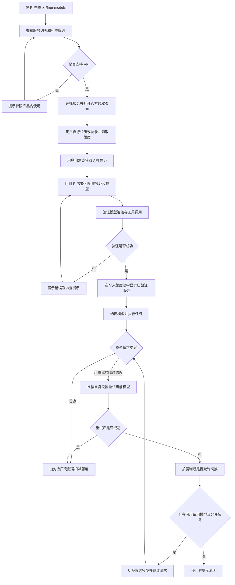

# 免费模型助手 PRD

状态：草稿  
日期：2026-11-15

## 背景与目标

许多模型服务商提供免费 API 额度，但领取方式、有效期、可用模型和接入方法各不相同。用户希望在 Pi 中找到适合个人编程和个人助手任务的服务，自行领取额度，再完成模型接入。

首版目标：让用户从终端查看经过核实的免费 API 服务，前往官方页面领取，并按照指引在 Pi 中连接一个模型，完成一次包含工具调用的任务。

产品方向：建立用户自己的 Pi 模型额度池。用户从插件打开厂商官方领取页，自行完成领取后，将厂商账号的 API 凭证关联到 Pi；插件统一展示已接入的服务及模型。额度仍由各厂商管理和扣减，不会实际转移或合并为 Pi 的通用 Token。

## 目标用户与场景

- 个人开发者：希望利用免费额度处理小型编码任务。
- 个人助手用户：希望让 Agent 处理本地文件、笔记等任务。
- 用户执行 `/free-models`，查看服务、领取规则与接入说明；自行领取后配置凭证，在 Pi 中选择模型并验证。

## 用户流程

额度池统一展示接入状态；只有服务商提供可靠的余额查询接口时才展示真实余额，否则标记为未知。用户可随时取消领取或配置，已领取额度保留在相应服务商账号中。

## 首版范围

### 服务目录

- 展示少量人工核实的服务，优先选择官方提供 API 的服务。
- 每条记录包含：服务商、官方领取与文档链接、额度及刷新周期、有效期、可用模型、API 可用性、地区或注册限制、超额处理方式和最近核实日期；未知信息明确标记。
- 区分自动刷新、人工领取和一次性赠送；明确标记仅限产品内使用的额度，不能将其当作 API 额度。
- 目录初期随插件发布，信息以服务商实际规则为准。AIHOT 可作为发现线索，不假设存在可用的羊毛数据接口。

### 用户操作

- 提供 `/free-models` 命令查看列表和详情，展示领取及接入链接。
- 提供打开官方领取页面的操作，并支持在无法打开浏览器时复制或手动访问链接。
- 用户自行注册、登录和领取；插件不代签、不承诺自动领取。
- 提供 Pi 内置服务商登录、兼容接口配置及模型选择的指引；密钥通过 Pi 支持的凭证管理或环境变量配置，不写入目录或日志。
- 提供个人额度池视图，区分未接入、已配置和已验证状态；真实余额仅在厂商提供可靠查询接口时展示，否则标记为未知。接入前由用户选择服务与模型，并确认其费用规则。
- 对至少一家已核实服务提供接入说明，并验证一次模型调用及一次实际工具调用。

### 费用与状态

- 展示免费范围及超额后的已知行为，不能确认时标记未知；不将插件的价格元数据视为服务商账单。
- 首版不承诺查询真实剩余额度；如果服务商提供可靠接口，可作为后续能力评估。
- 自动切换纳入首版验证：优先评估已有 Pi 开源扩展，使用用户明确配置的候选模型顺序；额度错误、限流和网络错误需区分，切换及失败原因对用户可见。全部不可用时停止并提示。
- Pi 自身可对部分临时故障重试当前模型；自动切换扩展负责在适用条件下选择备用模型。候选扩展 pi-auto-fallback 的文档描述为先经过 Pi 自身重试，再在最终结果仍为可重试错误时切换；并非所有错误都会触发重试或切换，具体顺序取决于所选扩展和配置。Pi 文档当前列出的默认值为最多重试 3 次、初始延迟 2 秒，用户设置或版本可能不同。
- 模型请求可能在已执行工具后失败；恢复时不得盲目重放已完成的写文件或命令。候选方案须明确验证这一行为，无法安全恢复时停止并提示。
- 默认仅允许用户确认的免费模型和服务；免费额度是否超额转付费由厂商控制，不能仅依赖错误触发来保证零费用。

## 不在首版范围

- 自动注册、绕过验证或自动签到。
- 聚合转售 API、提供统一中转服务或创建服务商账号。
- 承诺永久免费、无限额度或所有模型均适用于 Agent。
- 接入邮件、日历等个人助手工具；这些能力需要另行设计与授权。
- DeepSeek Harness（DSH）接入：首版先聚焦 Pi，后续再评估。

## 产品与技术方案

- 交付形态：Pi TypeScript Extension，注册 `/free-models` 命令；目录与展示逻辑分离，便于维护。
- 模型接入：优先使用 Pi 已有 Provider；兼容接口使用 `models.json`；需要特殊认证或动态发现时再评估 Provider Extension。
- 安装：开发验证前安装 Pi；Pi 是运行插件所需的宿主，编写和评审 PRD 不依赖安装。
- 数据：初版使用人工维护、可追溯来源的数据，不依赖未确认的 AIHOT 羊毛 API。复用第三方代码和数据时分别核查许可与使用条件。

## 验收标准

1. 在支持的 Pi 环境中加载插件后，`/free-models` 能展示服务列表及至少一家服务的详情。
2. 该服务详情包含官方链接、免费规则、API 适用范围、超额行为或未知标记、核实日期。
3. 用户能按说明自行配置凭证并选用模型；文档不要求把密钥提交到仓库。
4. 使用真实账号验证一次模型响应和工具调用；记录模型、测试日期、结果和已知限制。
5. 明确提示领取由用户完成，目录信息和模型成本可能变化。
6. 用户可从详情打开官方领取页，并在回来配置后看到对应服务的接入状态；未经厂商验证的余额显示为未知。
7. 使用可控的模拟限流或额度错误，验证从首选模型切换至已配置的备用模型；记录是否保留会话、如何处理已执行工具以及全部候选失败的行为。真实服务商的错误识别需另行验证。

## 自动切换的开源候选

- [pi-ccswitch-auto-switch](https://github.com/errorje/pi-ccswitch-auto-switch)：Pi 扩展，项目描述支持根据供应商和端点故障切换；MIT。需核验版本兼容性、错误分类、收费保护和工具执行后的恢复行为。
- [pi-auto-fallback](https://github.com/mengcody/pi-auto-fallback)：基于 Pi 模型注册表配置回退链；MIT。文档称默认在本次请求已有工具执行时禁止自动重放，需确认具体额度错误是否触发。
- [pi-high-availability](https://github.com/burggraf/pi-high-availability)：项目描述支持额度或容量问题时按账号和模型组切换；MIT。需验证当前 Pi 兼容性和凭证处理方式。
- [Pi 虚拟模型](https://docs.pi.dev/latest/virtual-models)：官方提供按请求路由和重试时选其他模型的扩展接口；适合评估现有扩展是否能够组合，自动切换并非安装后默认具备。

以上为文档调研结果，尚未安装或实测，不预设某个项目已满足所有验收标准。

## 待确认

- 首个接入服务商及用户所在地区、注册条件。
- 首版是否需要自动写入 Pi 配置，还是只提供配置指引。
- 是否仅供个人使用，还是未来对外发布；对外发布前需要核查所用数据及品牌的许可。
