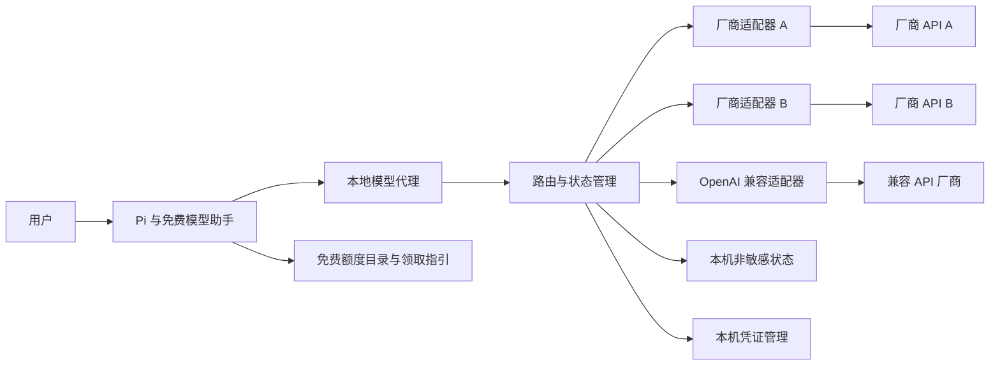

# 免费模型代理与额度池：设计草案

## 目标

参考 CLIProxyAPI 的账户、模型状态和路由机制，在 Pi 与模型厂商之间提供可扩展的统一入口。用户自行领取厂商额度并配置凭证；系统按用户允许的规则选择可用上游。额度仍由厂商管理，不跨账号合并。

## 调研依据

基于 [CLIProxyAPI](https://github.com/router-for-me/CLIProxyAPI) 提交 `e96d4c4818851cf0e96d27b2bc8b67379e449d9e`：

- `sdk/cliproxy/auth/types.go`：凭证记录关联 provider、状态、冷却时间和每个模型的状态。
- `sdk/cliproxy/auth/selector.go`：选择器先筛选当前可用的凭证，再按 provider 和模型执行轮询；项目也有优先填充等选择策略。
- `sdk/cliproxy/auth/conductor_cooldown.go`：对 429、认证错误及上游临时错误采取不同处理；根据 Retry-After 或退避计算重试时机。
- `sdk/api/handlers/`：对外暴露兼容不同协议的请求处理；适配器负责与具体上游交互。

以上是设计参考，不表示已完整移植。CLIProxyAPI 使用 MIT 许可；若复制或改写其代码，保留版权和许可证。

## 目标架构

## 关键设计

- **厂商适配器**：定义认证、模型目录、协议能力、错误解释与可选的余额查询接口。优先支持标准 OpenAI 兼容 API，再按需添加非标准接口；每家功能必须独立验证。
- **凭证与账号**：一个厂商可有多个用户授权的凭证；密钥放系统密钥链或用户选择的安全存储，不写入仓库、模型目录或日志。不要用多账号绕过厂商限额或条款。
- **池中实体**：区分服务商、账号、模型、可用状态与额度信息；同一账号下多个模型可能共享额度。余额来源和更新时间须可追溯，无法查询时显示未知。
- **调度**：用户选择允许的候选和顺序；按模型能力、上下文容量和费用规则筛选。默认优先使用当前可用模型，不盲目跨模型替换，避免改变任务能力或暴露内容给用户未选定的厂商。
- **冷却和恢复**：区分限流、明确的额度耗尽、认证失败、网络故障与模型不支持。仅在有可信信息时记录重置时间；429 不必然意味着额度耗尽。冷却结束表示可重试，不表示余额已恢复。
- **失败恢复**：只在响应尚未交付、且可以安全重试时尝试备用上游；流已输出或工具已经执行的场景需要明确处理边界，不重复执行副作用。全部候选不可用时返回可理解错误。
- **收费控制**：免费模型白名单与费用策略由用户确认；提供商可能在免费额度后自动扣费，单靠请求错误无法保证零费用。没有可靠上游限额或余额证据时不能宣称费用为零。

## 与当前实现的差距

当前插件只保存 Pi 模型 ID 列表及历史验证时间；切换发生在 Pi 扩展中，不是本地代理。当前没有独立账号池、厂商适配器接口、持久冷却状态、真实余额、统一 API 或可保证安全的跨协议流式恢复。现有 pi-auto-fallback 与 Pi 1.5.2 的真实服务商兼容性仍需验证。

## 实施顺序与验收

1. 固定支持范围与真实免费服务商，建立兼容 API 适配器和测试用模拟上游；可配置两个上游，不需要真实密钥即可测试。
2. 实现本地代理基本聊天和流式转发，验证请求、错误、工具调用往返和上下文；只监听本机并要求本地客户端凭证。
3. 实现凭证/模型状态、可配置顺序、冷却和重试，并验证 429、认证失败、临时故障、恢复及全部不可用。对部分流已输出和已执行工具的边界做专项验证。
4. 由 Pi 插件连接代理，完成领取引导、凭证配置、状态展示与真实账号端到端验证。真实余额、免费范围和费用保护逐家验证，未知时如实显示。

在代理实现及验证完成前，现有插件继续作为模型导航和有限的 Pi 内回退使用。
