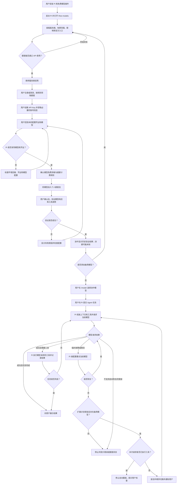

# Pi 免费 Token Agent：人机交互流程

> 此图记录早期 Pi 直连模型方案，尚未更新为 CLIProxyAPI 代理方案。当前产品流程和实现状态以 [免费模型助手 PRD](free-model-assistant-prd.md) 为准。

目标：用户自行获得服务商的免费 API 额度，在 Pi 中配置并验证模型，随后让 Agent 使用模型和工具完成任务；多个已配置模型可组成备用链。

## 端到端流程

## 交互节点与当前状态

| 环节 | 用户操作 | 当前实现与限制 |
| --- | --- | --- |
| 安装和启动 | 安装 Pi，在项目目录运行 `pi -e ./extensions/index.ts` | 可加载插件；需要从包含插件的目录启动。 |
| 查找与领取 | 在 `/free-models` 查看目录并打开官方页面 | 支持 Cloudflare 和 Gemini 入口。领取由用户在厂商处完成；Cloudflare 每日免费额度自动提供，无需签到。 |
| 凭证与模型 | 创建 API Key，配置给 Pi | **尚未实现插件内填写和保存凭证。** Cloudflare 当前需要在启动 Pi 前设置 `CLOUDFLARE_ACCOUNT_ID` 和 `CLOUDFLARE_API_TOKEN`；其他模型使用 Pi 的 `/login` 或模型配置。不要将密钥写入项目或聊天。 |
| 加入额度池 | 确认费用规则，从 Pi 已配置模型中选择 | 插件不判断真实免费资格；账号已配置不代表密钥有效或额度可用。至少配置两个模型才有备用链。 |
| 验证 | 选择“验证池中模型”并确认消耗 | 插件发送测试请求，检查工具调用往返；展示历史验证时间。当前还未用真实服务商账号完成端到端验证。 |
| 执行任务 | 通过 `/model` 选择池中模型，输入任务 | Pi 负责模型请求、工具执行和会话；模型决定是否调用工具。可用额度由服务商扣减，不转入 Pi。 |
| 自动切换 | 预先按顺序添加并确认候选模型 | Pi 先按自身设置处理可重试故障，插件复用 pi-auto-fallback 在适用时切换。只识别部分错误；已执行工具时默认不自动重放；全部失败时停止。上游声明支持 Pi 1.0 以下，本地在 Pi 1.5.2 仅完成加载和模拟测试。 |
| 余额与费用 | 在服务商控制台核实 | 插件不查询真实余额。免费额度耗尽后是否转付费由厂商与账户设置决定，自动切换不能保证零费用。 |

## 接下来需要补齐

1. 完善插件内的凭证配置引导与安全存储，避免用户每次手动设置环境变量；保留 Pi 原生登录和外部密钥管理方案。
2. 使用用户自己的真实账号验证 Cloudflare 模型的连接、工具调用和实际免费额度行为，不在文档或聊天中记录密钥。
3. 在 Pi 1.5.2 上使用可控故障验证回退、工具执行后的停止行为和全部候选不可用的提示，并核实各服务商的额度错误。
4. 视服务商官方能力评估余额查询、额度刷新和恢复后的再次可用；无可靠接口时继续显示未知。

详细需求见 [免费模型助手 PRD](free-model-assistant-prd.md)。
